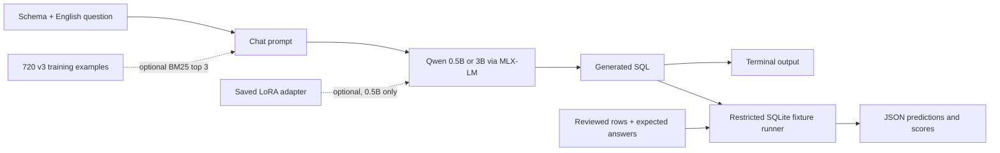

# SQL Fine-Tuning with MLX

A local text-to-SQL pipeline for Apple silicon. Generate SQLite queries from a schema and an English question, train LoRA adapters, retrieve relevant SQL examples, and compare model outputs by executing them against reviewed test databases.

The project uses Qwen2.5 instruction models through MLX-LM. The selected v3 adapter runs with the original 0.5B model; a separate 3B checkpoint and a retrieval baseline provide comparisons without additional project training.

[Architecture](docs/architecture.md) · [Data inventory](docs/data.md) · [Experiment record and full SQL outputs](docs/experiments.md)

## Architecture



| Component | Responsibility |
| --- | --- |
| Python 3.12 + `uv` | Reproducible environment and command execution |
| MLX | Model computation on the Apple GPU |
| MLX-LM 0.32.2 | Qwen loading, greedy generation and LoRA training |
| Transformers tokenizer | Chat formatting, tokenization and training-length checks |
| LoRA adapter | Learned parameter updates applied alongside the frozen 0.5B model |
| BM25 retriever | Selects training examples by schema/question word overlap; no embedding model or vector database |
| Python SQLite | Executes model queries in disposable, restricted databases and checks returned rows |

Generation prints SQL; it does not connect to an application database. Evaluation uses only the committed fixture definitions. The [architecture reference](docs/architecture.md) describes the code paths and execution restrictions.

## Experiment results

Recorded locally on an Apple M4 with 16 GB unified memory. A question passes only if its generated query returns correct results on all three fixture databases.

| Variant on the same 12 questions | Strict raw-response passes | Passes after code-fence-only cleanup |
| --- | ---: | ---: |
| Original Qwen2.5-0.5B-Instruct | 7/12 | 7/12 |
| Original 0.5B + three retrieved examples | 7/12 | 10/12 |
| Original Qwen2.5-3B-Instruct | 11/12 | 11/12 |
| Original 0.5B + selected v3 adapter | **12/12** | **12/12** |

The cleanup score is a separate post-hoc diagnostic: it removes one Markdown code fence without repairing SQL. Three otherwise-correct RAG queries failed only because they contained fences.

The 3B model's only miss converted a stored month-name date to ISO format. Excluding both date-convention questions, 3B and v3 tie at **10/10**. These are small synthetic, single-table tasks with patterns shared by the curriculum; the twelve questions were already inspected before the four-way follow-up. This is not a broad SQL benchmark.

Earlier training rounds are retained:

| Experiment | Training data | Updates / learning rate | Execution result |
| --- | --- | --- | --- |
| V1 | 1,000 public-data examples | 100 / 0.0001 | Regressed: 4/8 versus original 6/8 |
| V2 | 672 balanced generated examples | 600 / 0.00002; checkpoint 100 selected | Tied: 14/16 versus original 14/16 |
| V3 | 720 generated examples, including counting paraphrases and literal dates | 300 / 0.00001; checkpoint 300 selected | 12/12 versus original 7/12 |

The denominators represent different evaluation sets and must not be compared as one continuous accuracy metric. [Full experiment history, selection rules, per-question SQL and reproduction commands](docs/experiments.md).

## Data available

Counts below were checked against the local datasets and fixture definitions. Training counts are labelled conversations, not populated database rows.

| Dataset / role | Amount | What it contains | Location / availability |
| --- | --- | --- | --- |
| V1 public-data sample | 1,000 train, 100 validation, 100 reserved test | English questions, `CREATE TABLE` schemas and reference SQL; selected from 78,577 SQL Create Context records with disjoint table-name splits | `data/`; generated locally, excluded from Git |
| V2 curriculum | 672 train, 112 validation | Fourteen balanced single-table SQL task families; targets checked against independently calculated fixture answers | `data/v2/`; generated locally, excluded from Git |
| V3 curriculum | 720 train, 120 validation | Fifteen balanced families, counting paraphrases, literal month-name dates; 48 training and 8 validation examples per family | `data/v3/`; current training dataset, excluded from Git |
| RAG corpus | Same 720 v3 training examples | Schema/question/SQL examples retrieved at inference time; not an additional dataset | `data/v3/train.jsonl` |
| Original development suite | 8 questions, 24 fixtures | Unique-bike counts, NULL-aware counts, filters, dates, grouping and ordering | `fixtures/execution_cases.json`; committed |
| Opened v2 suite | 16 questions, 48 fixtures | New schemas/wording within the SQL task families; later used for v3 development | `fixtures/execution_holdout.json`; committed |
| V3 comparison suite | 12 questions, 36 fixtures | Distinct counts, filters, grouping, ordering and two date conventions; used for the recorded four-way comparison | `fixtures/execution_holdout_v3.json`; committed |

V3 covers row counts, filtered counts, distinct counts, non-NULL counts, minimum, maximum, average, filtered sums, sums per group, counts per group, ascending and descending order, text filters, numeric filters and literal-text dates. [Task examples, data formats, provenance and split boundaries](docs/data.md).

The original public dataset's populated databases are **not available** in this project. Execution fixtures are constructed test data, not those original databases. The reserved 100-example public test split remains unscored. There is no independent joins/subqueries benchmark or production database integration.

## Set up

Requirements: an Apple silicon Mac, `uv`, and access to this private repository. Python 3.12 is selected by `.python-version`; dependencies are pinned in `uv.lock`.

```bash
git clone https://github.com/khnguyenn/sql-finetune-mlx.git
cd sql-finetune-mlx
uv sync --locked
uv run python -c 'import mlx.core as mx; print(mx.default_device()); print(mx.metal.is_available())'
```

For an existing checkout, start at `uv sync --locked`. The GPU check should report a GPU device and `True`. Run model jobs one at a time on the 16 GB reference Mac.

| Asset | Existing prepared checkout | Fresh clone |
| --- | --- | --- |
| Source, configs, fixtures, documentation | Available | Included in Git |
| Generated v1/v2/v3 data | Available locally | Generate the version needed |
| Saved v1/v2/v3 adapters | Available locally; v3 selected | Copy a saved adapter or train a new one |
| Raw experiment reports | Available locally | Generate new reports; recorded tables remain in docs |
| Qwen model weights | Both 0.5B and 3B cached on the reference Mac | Downloaded from Hugging Face on first use |

Base model weights live in the Hugging Face cache, normally `~/.cache/huggingface/hub`, rather than `adapters/`. The 0.5B weights are approximately 1 GB; the 3B download is approximately 6.17 GB. Each selected LoRA adapter is approximately 5.61 MiB and requires its matching original model.

## Run or reuse a model

### Original model: no training data or adapter required

```bash
uv run python -m sql_finetune.ask \
  --schema 'CREATE TABLE products (name TEXT, price REAL);' \
  --question 'What is the highest product price?'
```

Expected SQL: `SELECT MAX(price) FROM products`. The first call downloads the original 0.5B checkpoint if it is not cached.

### Reuse the selected v3 adapter

Requires `adapters/sql-v3/adapter_config.json` and `adapters/sql-v3/adapters.safetensors` from the prepared checkout.

```bash
uv run python -m sql_finetune.ask --adapter adapters/sql-v3 \
  --schema 'CREATE TABLE products (name TEXT, price REAL);' \
  --question 'What is the highest product price?'
```

This loads the original model plus learned LoRA weights. It does not start or resume training. A clean clone without these local files can use the original model immediately or create a new adapter with the next section.

### Try the larger model or retrieval baseline

These commands generate and grade one existing comparison question, then save the SQL and fixture outcomes. Choose unused report filenames.

```bash
# Larger model, no extra project training.
uv run python -m sql_finetune.evaluate_execution \
  --model Qwen/Qwen2.5-3B-Instruct \
  --fixtures fixtures/execution_holdout_v3.json --case department-points \
  --out results/try-3b-01.json

# Original 0.5B model with three retrieved examples; requires v3 training data.
uv run python -m sql_finetune.evaluate_execution \
  --retrieval-corpus data/v3/train.jsonl --top-k 3 \
  --fixtures fixtures/execution_holdout_v3.json --case department-points \
  --out results/try-rag-01.json
```

These instruction checkpoints were already trained by their publisher; “no extra training” means no additional training by this project. RAG changes the prompt, not the model weights. The evaluator's primary score requires raw SQL, so a correct query wrapped in Markdown still fails that strict response contract.

## Train a new adapter

### 1. Prepare v3 data, or reuse the existing dataset

Only generate it when `data/v3/` is absent:

```bash
mkdir -p data
uv run python -m sql_finetune.prepare_curriculum --version 3
```

The generator creates 720 training and 120 validation conversations, checks their SQL against independent expected answers, checks evaluation-table separation and enforces the 512-token limit. It refuses to overwrite an existing version.

### 2. Start a fresh run in an unused adapter directory

```bash
uv run mlx_lm.lora --config configs/train-v3.yaml \
  --adapter-path adapters/sql-run-01
```

`--adapter-path` is the training output directory here. Choose an unused name to preserve the selected adapter and earlier runs. This command starts a fresh adapter from the original model; it does not continue v3 merely because `adapters/sql-v3/` exists.

```mermaid
flowchart LR
    Lessons["Schema + question + target SQL"] --> Tokens["Tokenize; mask prompt loss"]
    Tokens --> Forward["Frozen Qwen 0.5B + LoRA"]
    Forward --> Loss["Next-token loss on target SQL"]
    Loss --> Update["Adam updates LoRA parameters"]
    Update --> Save["Validation + saved checkpoints"]
    Save --> Select["Execution evaluation on development sets"]
    Select --> Reuse["Selected adapter for inference"]
```



| V3 setting | Value |
| --- | --- |
| Training steps / batch size | 300 / 1; less than a full pass through 720 examples |
| Learning rate | 0.00001 |
| Adapted layers / rank / scale | Last 8 supported layers / 8 / 16 |
| Maximum sequence length | 512 tokens |
| Prompt loss masking / gradient checkpointing | Enabled / enabled |
| Validation / checkpoint interval | Every 100 updates; 20 validation batches |

The original weights stay frozen. Training saves adapter weights, its configuration and intermediate snapshots; it does not save a standalone replacement for Qwen. Training optimizes SQL answer-token prediction, not executed database results, so lower loss alone does not establish better queries.

### 3. Use and evaluate the new adapter

```bash
uv run python -m sql_finetune.ask --adapter adapters/sql-run-01

uv run python -m sql_finetune.evaluate_execution \
  --out results/original-dev-01.json
uv run python -m sql_finetune.evaluate_execution \
  --adapter adapters/sql-run-01 --out results/sql-run-01-dev.json
```

Compare `correct_cases`, generated SQL and failed fixtures in the reports. The default suite is the original eight development questions; use `--fixtures fixtures/execution_holdout.json` for the additional sixteen opened questions. The recorded v3 checkpoint was selected on their combined 24 cases. Use development data to choose checkpoints, and define a new independent test before making a new generalization claim.

## Repository layout and validation

```text
sql_finetune/   Python modules: generation, data preparation, retrieval, grading
configs/       V1, v2 and v3 training recipes
fixtures/      Committed questions, schemas, database rows and expected results
tests/         Data-boundary, SQL-execution, retrieval and report regression checks
docs/          Architecture, data details and experiment evidence
data/          Local generated conversations and metadata; ignored by Git
adapters/      Local LoRA weights and checkpoints; ignored by Git
results/       Local predictions, scores, selection records and logs; ignored by Git
```

```bash
uv run python -m unittest discover -s tests
```

Tests validate data separation, independently calculated training targets, SQL execution restrictions, retrieval and strict-versus-formatting scores without loading a model. Python modules are run with `python -m sql_finetune.<module>` from the repository root. There is no QTMS dependency or validation wrapper in this project.

## References

- [MLX-LM](https://github.com/ml-explore/mlx-lm) and [LoRA training documentation](https://github.com/ml-explore/mlx-lm/blob/main/mlx_lm/LORA.md)
- [Qwen2.5-0.5B-Instruct](https://huggingface.co/Qwen/Qwen2.5-0.5B-Instruct) and [Qwen2.5-3B-Instruct](https://huggingface.co/Qwen/Qwen2.5-3B-Instruct)
- [SQL Create Context](https://huggingface.co/datasets/b-mc2/sql-create-context), CC BY 4.0; pinned dataset revision in [the data reference](docs/data.md)
