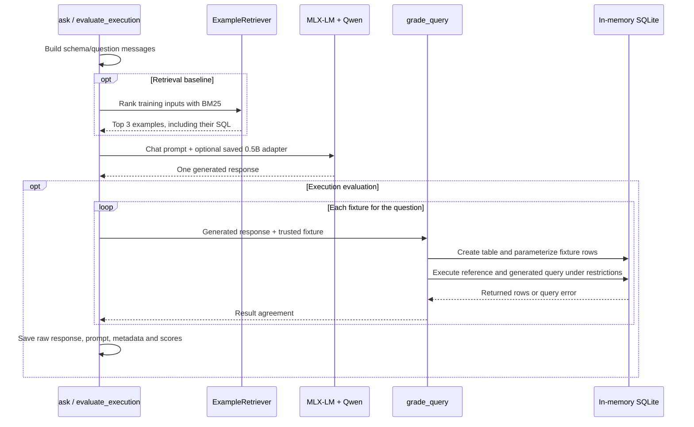

# Architecture

This is a command-line text-to-SQL pipeline. Python coordinates model inference, adapter-training data preparation, retrieval and execution evaluation. MLX-LM implements model loading and training; MLX performs the numerical work on Apple silicon.

## Generation and evaluation

`ask` prints the generated response. `evaluate_execution` additionally grades it. The model sees the target schema and question, plus retrieved training examples when enabled. Evaluation rows, expected answers and reference SQL are never part of that prompt.

## Training and selection

1. `prepare_curriculum.build_examples()` creates labelled schema/question/SQL conversations and independent expected results. `execution.grade_query()` checks each target SQL against those results.
2. `prepare_curriculum.main()` checks evaluation-table separation, token length and split boundaries, then writes versioned JSONL and metadata. Existing versions are preserved.
3. `mlx_lm.lora`, configured by `configs/train-v3.yaml`, loads the original 0.5B model, freezes its weights and attaches trainable LoRA parameters to the last eight supported transformer layers.
4. MLX-LM tokenizes each conversation, masks prompt loss and predicts the assistant SQL tokens. Adam updates the adapter parameters; the frozen model still participates in the forward and backward computation.
5. Validation measures token loss. Saved adapter checkpoints are evaluated by generating SQL and executing it on development fixtures. Execution scoring does not feed a reward or gradient back into this training loop.
6. The selected adapter is loaded alongside the same original checkpoint for future inference. It is neither a standalone model nor a copy of the training dataset.

The recorded v3 selection used 24 opened development questions. The final twelve-question comparison was separate at selection time, but has since been inspected and reused. Details and results are in [experiments](experiments.md).

## Modules and stored state

| Module / artifact | Responsibility |
| --- | --- |
| `sql_finetune.common` | Shared original model ID, system prompt and committed fixture location |
| `sql_finetune.ask` | Original/v3 single-question generation |
| `sql_finetune.prepare_data` | Historical public-data sample and disjoint table-name splits |
| `sql_finetune.prepare_curriculum` | V2/v3 generated training data and independent target checks |
| `sql_finetune.retrieval` | BM25 input ranking and retrieved-example prompt construction |
| `sql_finetune.evaluate_execution` | Select model/adapter/retrieval, generate once, grade and save results |
| `sql_finetune.execution` | Restricted query execution and row comparison |
| `sql_finetune.compare_results` | Regrade saved outputs, keeping strict and fence-only diagnostics separate |
| `sql_finetune.evaluate` | Historical normalized-text-match metric; not execution accuracy |
| `configs/`, `fixtures/` | Committed training recipes and reviewed database scenarios |
| `data/` | Local JSONL conversations and dataset metadata |
| `adapters/` | Local LoRA configurations, weights and checkpoint snapshots |
| `results/` | Local predictions, per-fixture outcomes, selection records and logs |
| Hugging Face cache | Publisher model weights and tokenizer files, outside the repository |

## Retrieval boundary

The index uses only the input schema/question text from trusted training conversations. Family labels and SQL answers do not affect ranking. Selected SQL answers are then supplied as examples. BM25 uses lowercase alphanumeric tokens, `k1=1.5`, `b=0.75`, a source-line tie break and exact-input exclusion. The comparison fixes top-k at three. Similar examples may occupy multiple slots; there is no diversity reranker or semantic embedding model.

## SQL execution boundary

Fixture schemas and rows are trusted, reviewed project data. Model output is untrusted. Each query runs in a disposable in-memory database with `query_only` enabled and a deny-by-default authorizer. Only reads from the fixture table and a small allowlist of built-in functions are permitted. Writes, attachments, PRAGMAs, metadata reads, extensions and multiple statements are rejected.

Limits are 16,000 SQL bytes, 1,000,000 value bytes, 1,000 returned rows and 65,536 encoded result bytes. A progress callback checks approximately every 1,000 SQLite instructions and interrupts after 100,000 instructions or about 0.25 seconds. This is not an OS-level hard timeout or a sandbox for arbitrary unreviewed fixture setup.

The grader validates the reference against handwritten expected rows first; broken fixtures stop evaluation. Candidate SQL errors count as failures. Column count must agree, duplicates are preserved, and row order is checked when required. Unsupported binary/non-finite outputs become query failures. These fixtures use directly comparable values, without floating-point tolerance.

Strict scoring uses the raw response. A separate post-hoc diagnostic strips only one whole-response SQL/untagged Markdown fence and uses the same restrictions. It does not repair SQL or accept surrounding prose. Passing these fixtures is evidence for the supplied scenarios, not proof of SQL equivalence on every database.
